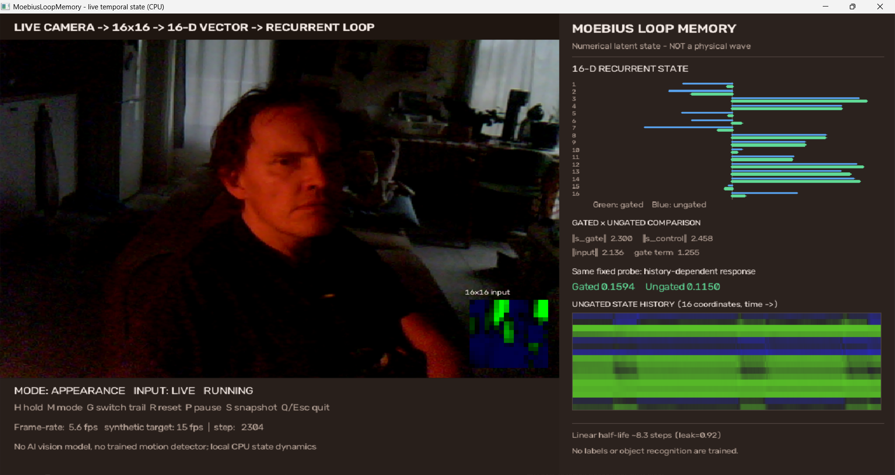

# MoebiusLoopMemory

An auditable **temporal memory + contextual gating** research sandbox. It is *not* a model of a real neuron, a physical wave solver, or evidence for a unique advantage of Möbius topology.

**Question:** Can a compact circulating state retain past stimuli while a local, dendrite-inspired multiplicative gate makes relationships between earlier events available to a **linear readout**?

## Run (Python 3.13, Windows or Linux)

~~~bash
python -m pip install -r requirements.txt
python demo.py --history 101100101011
python benchmark.py --seeds 5 --train 1200 --test 600 --json results.json
python probe.py --csv probe_results.csv
python -m unittest discover -s tests -v
~~~

The demo recognizes **whether the two symbols immediately preceding the latest symbol match**, based solely on the final 16-component state and a trained linear output. The recurrence and gate weights are fixed random matrices; the demo tests on new held-out sequences.

## Model

~~~python
r = R @ state
b = B @ input
context = tanh(A @ r)
new_state = tanh(leak * r + b + gate * b * context)
~~~

At final readout, optionally L2-normalize. No physical energy conservation is implied. The gate is a mathematical *analogy* to dendritic contextual modulation, not a biophysical model. Input vectors encode antipodal symbols (+v/-v); the readout is **strictly linear ridge regression** plus intercept (no quadratic decoder features).

Signed shift obeys R^D = -I and R^(2D) = I. Cyclic shift obeys R^D = I. A sign-reversed boundary condition in feature space is not a literal Möbius strip or cortical wave.

## Benchmarks and falsification controls

Within each seed, every architecture receives **identical input symbols and noise**, using independent held-out sequences. Conditions: signed shift, unsigned cyclic shift, random orthogonal rotation and identity recurrence, each with or without a gate; plus exactly linear controls.

**Locally verified 2026-10-29:** five random seeds; 1,200 training + 600 held-out samples per seed, 12 timesteps, 16 dimensions, input noise SD=0.01. Means across seeds (per-seed variation available from --json).

| Architecture | lag 4 recall | lag 6 recall | XOR(lags 1,2) | XOR(lags 2,3) | XOR(lags 2,3), state erased |
|---|---:|---:|---:|---:|---:|
| Signed + gate | 94.7% | 75.9% | **87.0%** | **83.3%** | 48.0% |
| Cyclic + gate | 94.1% | 78.3% | **87.2%** | 80.8% | 47.8% |
| Orthogonal + gate | 97.2% | 82.5% | **87.5%** | 79.4% | 50.0% |
| Identity + gate | 64.5% | 66.7% | 74.1% | 67.3% | 50.0% |
| Signed, gate disabled | **100%** | **97.3%** | 52.8% | 50.9% | 48.3% |
| Signed, exactly linear | **100%** | **100%** | 51.3% | 49.6% | 48.4% |

**Interpretation:** Circulation retains individual past bits while gating turns relationships between earlier bits into linearly readable features. Gating reduces linear recall. **Ordinary cyclic rotation ties signed shift on historical XOR**; no special Möbius advantage demonstrated. High recall for the perfectly linear, noise-light 16D reservoir is expected from linearly distinct directions created by rotations over a 12-step input. This is a synthetic representation, not a brain memory-capacity estimate. No advantage against Wave-RNN, LSTM, GRU or a nonlinear readout has been established.

## Delayed probe

Write +v/-v, apply zero inputs for a configurable delay, then probe with +v/-v. The probe experiment measures the **difference of differences** of raw final states:

~~~text
D = [S(+history,+probe) - S(+history,-probe)]
  - [S(-history,+probe) - S(-history,-probe)]
~~~

An odd, ungated reservoir must give D=0 for antipodal input, even if its state uses odd tanh nonlinearity. With a gate and signed shift the interaction norm fades from 2.5896 at delay 0 to 0.4910 at 16, and 0.0088 at 64 (one deterministic preparation). Cyclic and identity gated controls also show fading. This is **history-dependent nonlinear response**, not physical energy backflow or proof of silent neuronal storage.

## Connections to neuroscience and AI (hypotheses, not equivalences)

- [Keller et al., *Traveling Waves Encode the Recent Past and Enhance Sequence Learning* (ICLR 2024)](https://proceedings.iclr.cc/paper_files/paper/2024/hash/374fc6371864f800f213bf8a248f1117-Abstract-Conference.html): most relevant neural-network benchmark, Wave-RNN. Our feature-space shift is *not* a spatial Wave-RNN.
- [Muller, Churchland & Sejnowski, *Transformers and cortical waves: encoders for pulling in context across time* (2024)](https://pubmed.ncbi.nlm.nih.gov/39341729/): proposes waves as spatiotemporal contextual encoders.
- [Quaresima et al., *The Tripod neuron* (2023)](https://doi.org/10.1113/JP283399): dendritic plateau states perform temporal binding and sequence recognition.
- [Hughes et al., *Wave physics as an analog recurrent neural network* (2019)](https://doi.org/10.1126/sciadv.aay6946): physical wave dynamics and recurrent computation.

## Next falsification milestones

1. Out-of-distribution delays, amplitudes, noise, multiple input channels and adversarial order/recency controls.
2. Match parameter/state/compute budgets to trained GRUs, LSTMs and published Wave-RNN, with quadratic-readout controls.
3. Pre-register a task that specifically predicts a signed boundary advantage at D and 2D circulations; reject the Möbius-specific conjecture if it does not appear.
4. Replace the imposed rotation with a propagating phase field and measured power/damping budget; demonstrate history-dependent probe response without privileged stored registers.
5. Compare the computational predictions with dendritic plateau models and actual cortical traveling-wave recordings; no inference about qualia from toy experiments.

## Status

All core code uses NumPy and is intended for replication and falsification. Nine unit tests passed locally on Python 3.13. The 2026-10-29 results and limitations are recorded in RESULTS.md.

## Live webcam temporal-memory demo (offline, CPU)

This is a **visualization of the existing equations**, not a trained vision recognizer or a biological wave simulation.

### Windows / Python 3.13

~~~powershell
python3.13 -m pip install -r requirements-webcam.txt
python3.13 webcam_demo.py --mirror
~~~

If camera 0 is occupied or unavailable, try \`python3.13 webcam_demo.py --source 1\`. To test without a webcam:

~~~powershell
python3.13 webcam_demo.py --simulate
python3.13 -m unittest discover -s tests -v
~~~

You may also process an existing video with \`--source example.mp4\` or save a generated dashboard image with \`--simulate --max-frames 160 --no-display --save-preview preview.png\`.

**Controls:** H = stop feeding input while letting the state fade; M = alternate CHANGE and APPEARANCE (resets history); G = switch the displayed history trace between gated and ungated; R = reset; P = pause simulation and camera acquisition; S = save a screenshot locally; Q/Escape = exit.

**What happens:** 16x16 grayscale -> fixed 256-to-16 random projection -> \`LoopMemory.advance\` each frame. The right panel shows 16 state coordinates for two matched recurrent networks (with and without an apical-inspired gate), the selected state history, and the effect of the **same fixed hypothetical probe** in each current state. The probe calculation does **not** modify the stored state. In CHANGE mode an identical frame produces zero input, so fading is visible when the scene stops changing or H is pressed. APPEARANCE mode continuously injects the image and therefore is not a passive fading-memory demonstration.

**Interpretation constraints:**
- A webcam frame is compressed from 256 image pixels to 16 numbers; that is lossy. The earlier synthetic benchmark does *not* establish high-fidelity visual-frame recall.
- The readout is **not trained** on real webcam motion, objects, or gestures. Nonzero gate/probe numbers measure numerical state interactions, not recognized actions.
- 0.92 leakage corresponds to a small-signal linear half-life of about 8.3 processed frames, **not a fixed number of seconds**. Real capture rate varies; this demo advances once per processed frame.
- OpenCV works on local frames and nothing is uploaded. Images are saved only when S or --save-preview is used.
- This is the original discrete 16D recurrence, not a physical traveling wave, neuron, or real Möbius strip.
